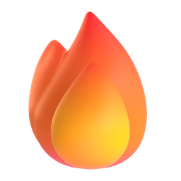

# Mohamed Alhinawi

### Software Engineer - web apps, desktop apps and complete products on whatever stack fits, shipped end to end

---

## What I ship

Full products, end to end: design, frontend, backend, databases, deployment — most of
them live on Cloudflare's edge, all of them in production today.

| Project | What it is | Live |
| :-- | :-- | :-- |
| **Menschen.** | The Hueber Menschen A1 German coursebooks, fully interactive: real page flip, original audio, tap any word for its Egyptian Arabic meaning, self-checking exercises, accounts and a class leaderboard | [menscheny.pages.dev](https://menscheny.pages.dev) |
| **Henglish Academy** | A complete English-learning academy in Egyptian Arabic: 16 full grammar courses, interactive tutor, 3D learning world, real-life simulators, placement tests and certificates | [henglish.pages.dev](https://henglish.pages.dev) |
| **Chesti** | Learn chess like a friend explaining next to you: hands-on lessons, engine-checked puzzles, opening traps, miniatures, play the computer or a friend | [chesti.pages.dev](https://chesti.pages.dev) |
| **Lahjaty** | The Arabic dialects side by side: lessons by situation, compare view across dialects, practice games, fully prerendered and offline-capable | [lahjaty.pages.dev](https://lahjaty.pages.dev) |
| **Lbasy** | A real online store for one-of-a-kind imported second-hand clothes: drops, per-governorate shipping, COD, WhatsApp ordering, full admin | [lbasy.pages.dev](https://lbasy.pages.dev) |
| **egypti** | An independent Egypt travel guide in Arabic and English: verified places, honest labels, 18 themes, synced bookmarks | [egypti.pages.dev](https://egypti.pages.dev) |
| **Deutschy** | German from A1 to C2 with real photos, five game modes and Egyptian Arabic explanations | [deutschy.pages.dev](https://deutschy.pages.dev) |
| **Dokkany** | Enterprise e-commerce admin & analytics dashboard: catalog, KPIs, demo mode, smart pagination | [dokkany.vercel.app](https://dokkany.vercel.app) |
| **telegram-notifier** | A Telegram bridge for coding agents: task-finished alerts, approval buttons, and two-way control from your phone | `npx skills add alhinawi/telegram-notifier` |

---

## Tech Stack 🧰

  
  
  
  
  
  
  
  
  
  
  
  
  
  
  
  
  
  
  
  

---

## Reach me

  
  
  

---

💻 Built with 💙 and whatever stack fits - powered by strong tea and late nights.

